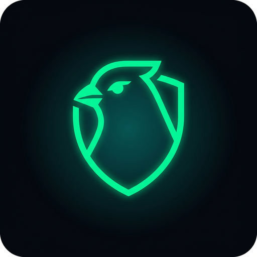

# Canary Duress Lock — نظام التمويه وقفل الطوارئ

**Production-ready anti-coercion vault for Android.** Two PINs, one gate: your master PIN opens the
real AES-256 vault; your duress PIN silently destroys the hardware-backed key and hands the
inspector a working calculator app instead.

```
Flutter 3.22+  ·  Kotlin 1.9  ·  Android 6.0+ (API 23)  ·  ARM64 release APK
```

<p align="center">
  
</p>

---

## ⬇️ Signed APK

**[`dist/CanaryDuressLock-v1.0.0.apk`](dist/CanaryDuressLock-v1.0.0.apk)** — 781 KB, signed (v1 + v2 + v3), ready to install.

```bash
adb install -r dist/CanaryDuressLock-v1.0.0.apk
# or copy it to the phone and tap it (allow "install unknown apps" for your file manager)
```

| | |
|---|---|
| Package | `com.canary.duresslock` |
| Version | 1.0.0 (versionCode 1) |
| Min / target SDK | 23 (Android 6.0) / 34 |
| ABIs | architecture-independent (pure DEX, no native libs) — arm64-v8a, armeabi-v7a, x86_64 |
| SHA-256 | `dba33db328a012fcb449aeceff2f8c6bb4f1dbe2cd597a75da8c67a319350fba` |

**First launch:** wizard asks for a master PIN → duress PIN → response action.
Use `123456` / `654321` if you just want to look around — mock testing mode is **on** by default, so
the duress path logs the purge instead of destroying anything.

**This APK is the native Kotlin build** (see [`native/`](native)), not the Flutter build. The Flutter
engine, Dart SDK and Gradle plugins all live on hosts that were unreachable while this session ran,
so the Flutter APK could not be compiled here — `native/` reproduces the full flow and the same
`security/` Kotlin sources with framework views only, and builds with just a JDK + `build-tools` +
`kotlinc`. For the Flutter APK run `flutter build apk --release --target-platform android-arm64`
(see [BUILD.md](BUILD.md)); a workflow that does this for you is in
[`.github/workflows/build-apk.yml`](.github/workflows/build-apk.yml).

---

## Live preview

An interactive, high-fidelity simulation of the whole flow (lock gate → vault → duress purge →
decoy) lives in [`web_preview/`](web_preview). It mirrors the Flutter widgets one-to-one, so you
can review the UX and the exact native call sequence without flashing an APK.

```bash
cd web_preview
npm install
npm run dev        # http://localhost:5173
```

**Try it:** master `123456` → encrypted vault · duress `654321` → mock purge log → decoy.
Leave the decoy by tapping the **Smart Tools** title five times.

---

## Architecture

```
┌──────────────┐  master PIN   ┌───────────────┐  lock  ┌──────────────┐
│   LOCK GATE  │──────────────▶│  REAL VAULT   │───────▶│   LOCK GATE  │
│  (obsidian)  │               │  AES-256-GCM  │        │              │
└──────┬───────┘               └───────────────┘        └──────────────┘
       │ duress PIN — visually identical, no error
       ▼
┌──────────────────────────────────────────────────────────────────────┐
│ 1. keyStore.deleteEntry(MASTER_ALIAS)   ← key destroyed in StrongBox │
│ 2. keyStore.deleteEntry(BIOMETRIC_ALIAS)                             │
│ 3. MemoryZeroizer.zeroizeAll()          ← Arrays.fill(0x00) ×3        │
│ 4. clearSecureStorage()                 ← prefs + Hive key table      │
│ 5. optional: devicePolicyManager.wipeData(0)                          │
│ 6. → DECOY (calculator · notes · gallery)                             │
└──────────────────────────────────────────────────────────────────────┘
```

### Repository layout

| Path | Purpose |
|---|---|
| `lib/app.dart` | Root state machine: `locked → vault → decoy` |
| `lib/core/theme/app_theme.dart` | Cyber-stealth dark theme + decoy light theme |
| `lib/core/constants/app_constants.dart` | Key aliases, PIN spec, vault & decoy fixtures |
| `lib/core/services/duress_service.dart` | Dual-PIN verification + purge orchestration |
| `lib/core/services/storage_service.dart` | Hive-backed vault storage abstraction |
| `lib/core/platform/method_channel_service.dart` | Dart ⇄ Kotlin bridge (3 channels) |
| `lib/features/auth/` | `LockScreen` (gate + first-launch wizard), `PinInputWidget` |
| `lib/features/vault/` | `VaultScreen` (items, status cards, quick actions) |
| `lib/features/config/` | `DuressConfigModal` (action selector, toggles, PIN change) |
| `lib/features/decoy/` | `DecoyScreen`, `CalculatorDecoy`, `NotesDecoy`, `GalleryDecoy` |
| `android/.../security/KeyStoreManager.kt` | StrongBox/TEE AES-256-GCM, encrypt/decrypt, purge |
| `android/.../security/MemoryZeroizer.kt` | Multi-pass `Arrays.fill` buffer wiping |
| `android/.../security/DuressTriggerReceiver.kt` | Broadcast receiver → purge dispatch |
| `android/.../security/DeviceAdminReceiver.kt` | `DevicePolicyManager.wipeData(0)` authority |
| `android/.../security/AccessibilityMonitorService.kt` | Optional system-level monitor (off by default) |
| `android/.../MainActivity.kt` | Flutter entry + three native MethodChannels |
| `web_preview/` | Interactive UX simulation (React + Vite) |

---

## The three duress actions

| # | Action | What happens | Recoverable? |
|---|---|---|---|
| 1 | **Decoy only** | Fake environment, vault untouched but hidden | Yes |
| 2 | **Decoy + purge keys** (recommended) | Keys deleted from KeyStore, memory zeroized, decoy shown | No, without backup |
| 3 | **Hard wipe** | Purge, then `DevicePolicyManager.wipeData(0)` | No |

Select it in **Vault → shield icon → Duress response action**.

---

## Build

```bash
flutter pub get

# ARM64 release APK (per spec)
flutter build apk --release --target-platform android-arm64
# → build/app/outputs/flutter-apk/app-release.apk

# or straight through Gradle
cd android && ./gradlew assembleRelease
```

Details, signing, verification commands and CI snippet: **[BUILD.md](BUILD.md)**.

---

## Mock Testing Mode

Non-negotiable for development: **never test a real purge on data you want to keep.**

Enable it on the lock screen (amber banner → `CONFIG`) or in **Duress configuration**. With mock
mode on, the duress sequence is fully simulated and printed line-by-line:

```
[21:12:04] DURESS TRIGGERED — Action: Decoy + Purge — Delete keys & show decoy
[21:12:04] Mock Testing Mode: true
[21:12:04] [MOCK] Simulating KeyStore purge for alias: canary_master_vault_key_v1
[21:12:05] [MOCK] KeyStore entry deleted — AES-256 key purged
[21:12:05] [MOCK] Memory zeroization — byte arrays wiped (Arrays.fill 0x00)
[21:12:05] [MOCK]BLOCKED — Mock mode prevents actual wipe      ← only for action 3
[21:12:05] MOCK SEQUENCE COMPLETE — No data was actually deleted
```

The decoy hand-off is exercised for real, so the whole UX is verified end-to-end.

---

## Security notes (read before shipping)

- **Keys** are created with `KeyGenParameterSpec` (`AES/GCM/NoPadding`, 256-bit, randomized IV) and
  `setIsStrongBoxBacked(true)` where available, falling back to TEE, then to a plain software key.
  `KeyStoreManager.getKeyInfo()` reports `insideSecureHardware` / `isStrongBoxBacked` so the UI can
  tell you which one you actually got.
- **Purge** is `keyStore.deleteEntry(alias)` followed by a `containsAlias` verification and the
  removal of the associated secure-prefs entries. Deleting a KeyStore key destroys the material —
  ciphertext left behind is unrecoverable.
- **Zeroization** overwrites every registered buffer three times (0x00 → 0xFF → 0x00) and bumps a
  `@Volatile` counter to stop the JIT from eliding the fills. This is best-effort hardening, not a
  guarantee: Android has no mlock/zeroize guarantees for managed memory.
- **PINs** are stored as `SHA-256(pepper ‖ PIN)`. That is a UI gate, not a key-derivation function —
  the real protection is the hardware key. A 6-digit PIN has 10⁶ combinations; enforce the lockout
  policy (`maxFailedAttempts`, `lockoutDurationMinutes`) and consider raising the length for
  high-threat deployments.
- **Duress precedence**: the duress hash is checked *before* the master hash, so the two can never
  collide. The wizard and config modal also refuse identical PINs.
- **Backups**: `allowBackup="false"` plus `res/xml/data_extraction_rules.xml` keep vault data out of
  cloud backup and device transfer.
- **`USE_KEYSTORE` is not a real Android permission** — hardware-backed keys come from the OS
  provider and need no runtime grant. The manifest declares `USE_BIOMETRIC`, `BIND_DEVICE_ADMIN` and
  `BIND_ACCESSIBILITY_SERVICE`; the latter two are additionally enforced on the component
  (`android:permission`) which is what actually binds them.
- **Screenshots**: `FLAG_SECURE` is intentionally commented out in `MainActivity.onCreate()` so the
  emulator flow is testable. Uncomment it for production — it blocks screenshots and screen
  recording of the vault.

### Threat model honesty

This app defeats a *casual* coercive inspection by a person holding your unlocked phone. It is not
efficient against forensic imaging, a rooted device with a kernel exploit, or an adversary who
knows the design (e.g. they ask you to open the "Smart Tools" calculator and use it). Coercion
resistant design is a legal and personal-safety problem as much as a technical one; `wipeData(0)` in
particular is irreversible and can destroy evidence you later need — keep a sealed backup elsewhere.

---

## Permissions

| Permission | Used for | Required? |
|---|---|---|
| `USE_BIOMETRIC` / `USE_FINGERPRINT` | biometric-bound KeyStore keys | optional |
| `BIND_DEVICE_ADMIN` | hard-wipe action only | optional (action 3) |
| `BIND_ACCESSIBILITY_SERVICE` | optional system-level duress monitor | optional, off by default |
| `VIBRATE` | haptics on PIN entry | yes |

The app is fully functional with only KeyStore + vibration.

---

## Roadmap

- [ ] Real file ingestion (photos/documents) with streaming AES-GCM encryption
- [ ] Duress triggered by a hardware-key combo (accessibility monitor)
- [ ] `FLAG_SECURE` per-screen toggle (vault on, decoy off)
- [ ] Encrypted export / sealed backup for the vault key
- [ ] Instrumented tests for purge path on a physical device with StrongBox

---

<p align="center">
<sub>MIT licensed — audit the crypto before you trust it with your life.</sub>
</p>
